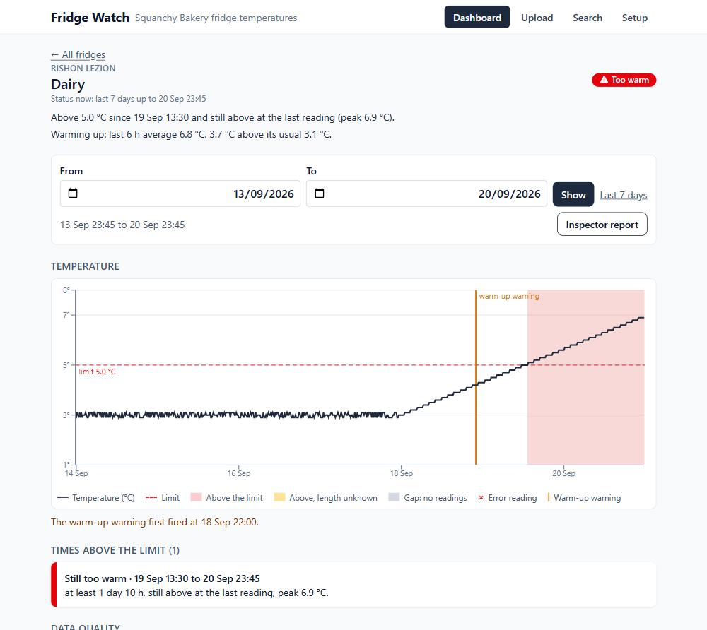

# Fridge Watch (Squanchy Bakery)

Upload the weekly logger files (Excel .xlsx, CSV/TSV, or rows pasted from Excel), see every fridge's status on one
screen (built for a phone first), and answer the Ministry of Health inspector: "when did this fridge go above 5 °C, and
for how long?"



## Requirements
- Node.js 22.13 or newer (developed on 22.23 and 24.12). Nothing else: no accounts, no paid or online services, no
  database to install (it uses Node's built-in SQLite).
- Node prints `ExperimentalWarning: SQLite is an experimental feature`. That is expected.

## Run
```bash
git clone https://github.com/Michal-Feder/fridge-monitoring-system.git
cd fridge-monitoring-system
npm install
npm run seed
npm run dev
```
Then open http://localhost:5173.

- `npm run seed` deletes the database and rebuilds the demo: one week (14-20 Sep 2026, plus 4 days before it) for 12
  branches. It writes the sample CSV files to `sample-data/` and imports them through the real upload code. It always
  produces the same data, and anything uploaded before is gone.
- `npm run seed -- --empty` creates an empty database instead, to try the upload from zero.
- `npm test` runs all tests.
- `npm run build` then `npm start` serves the built app and the API on http://localhost:3001.

### Windows notes
- Use **Command Prompt**, or type `npm.cmd` instead of `npm` in PowerShell if it says
  `npm.ps1 cannot be loaded because running scripts is disabled on this system`.
- If `npm run seed` fails with `EPERM` / `Cannot delete ...fridge.db`, the dev server still has the database open:
  stop it (Ctrl+C in its window, answer `Y`), run the seed, then start `npm run dev` again.

## Try it
Everything below is in the seeded data. "Now" is the latest reading uploaded (20 Sep 23:45), not today's date.

1. **Dashboard**: what needs attention comes first; the fridges that are fine are one row ("19 fridges OK · show")
   that opens to the branches.
   - **Rishon LeZion / Dairy** is the slow two-day warm-up from Summer's story: open it. The chart shows the
     warm-up warning on 18 Sep 22:00, well before it went above 5.0 °C on 19 Sep 13:30 (red, "Too warm").
   - **Rishon LeZion / Cream cakes** is the fast rise from the email: above 5 °C on 14 Sep 06:15-08:00, back to normal
     since 08:15, so it shows "Was too warm – check the products" (red outline), not "Too warm".
   - **Haifa / Dairy**: its logger TL-0231 records in °F (38.3 °F = 3.5 °C), confirmed once and converted; the
     original values are kept.
   - **Tel Aviv**: short door-open spikes (labelled, never red), and logger TL-0417 moved from Walk-in to Display 2 on
     17 Sep. Walk-in has no logger since then and is grey ("No reliable data"). Display 2 is grey too: it only has
     readings since 17 Sep, about half the week, and a fridge with less than 80% of the period covered is never green.
2. **Inspector report**: on a fridge page press "Inspector report", pick a period, print. Try Rishon / Cream cakes
   for 14 Sep. A period with missing readings says so in the first sentence. "Whole branch" (also on the dashboard)
   prints one document per branch: a summary table on page 1, then one page per fridge.
3. **Upload**: run `npm run seed -- --empty` (stop the dev server first on Windows), start `npm run dev`, then upload
   `sample-data/email-sample.xlsx` or `sample-data/email-sample.csv` (the 16 rows from Summer's email, as an Excel
   file and as text: both give the same preview). The preview shows 1 exact duplicate, 1 ERR, the
   2 h 15 min Jerusalem gap and the TL-0417 move, and asks you to confirm the unit of each of the 4 new loggers
   before anything is saved (°F is suggested for Haifa's 38.3, never pre-selected).
   Then upload `sample-data/new-logger-TL-0240.csv`: an unknown logger in °F that needs a branch and fridge.
   The other files in `sample-data/` are messy on purpose (shifted columns, two date formats, duplicates, conflicts).
   An old Excel file (.xls) is refused with "Save it as .xlsx or CSV".
4. **Search**: "fridges above X °C for at least N minutes" ("Include times with unknown length (safer)" or "Only times
   we know lasted that long"); "Print results" prints the query in words and every match with its coverage (or says nothing matched and how many fridges were checked).
5. **Setup**: add a fridge, move a logger, change a logger's unit (all its readings are recomputed from the originals).

## Docs
- `DECISIONS.md`: every rule and why (D1-D51), including the questions for Summer.
- `NOTES.md`: time spent, decisions Summer did not ask for, open questions, what is not done, AI mistakes.
- `AI_LOG.md`: every AI suggestion that was wrong or rejected, and how it was caught.
- `INIT.md` / `PLAN.md`: the build spec and checklist. `CLAUDE.md`: rules for AI tools in this repo.
- `docs/HANDOFF.md`: the step-by-step brief Claude Code built the app from (kept unchanged).
